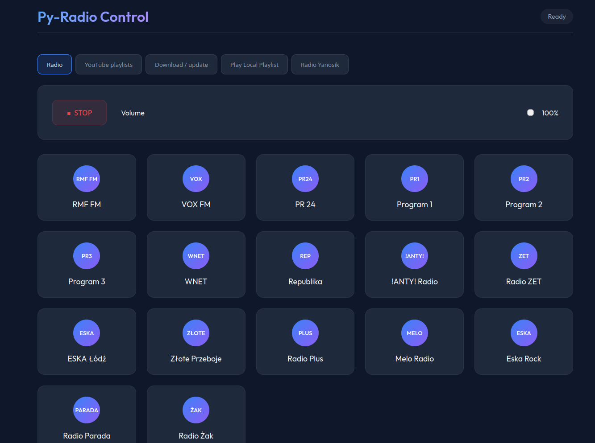
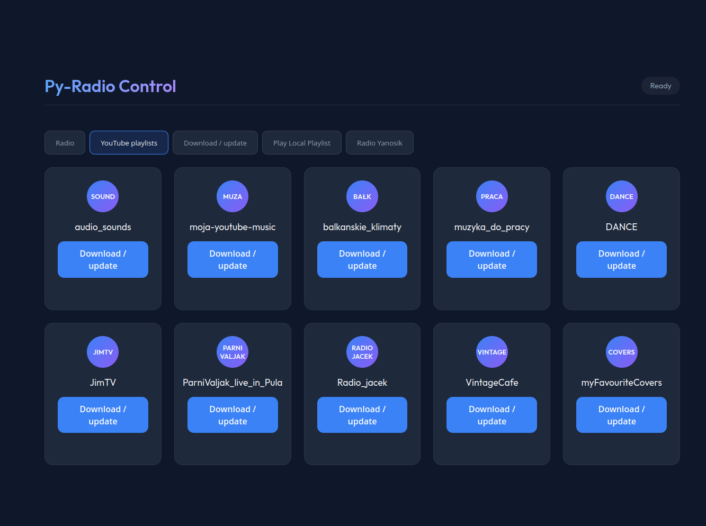
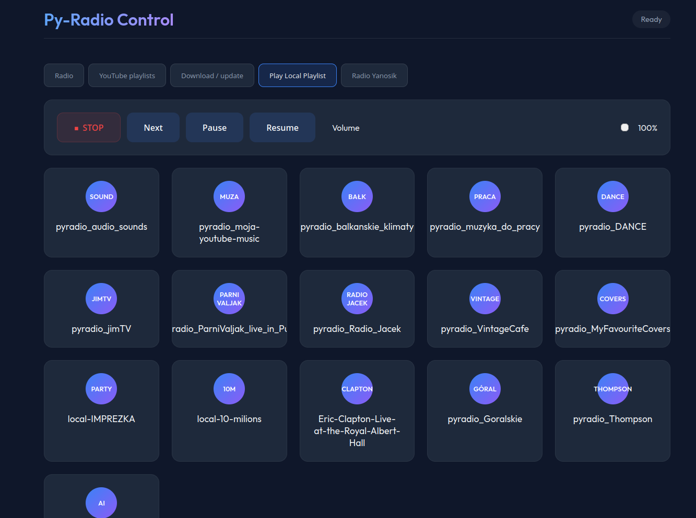
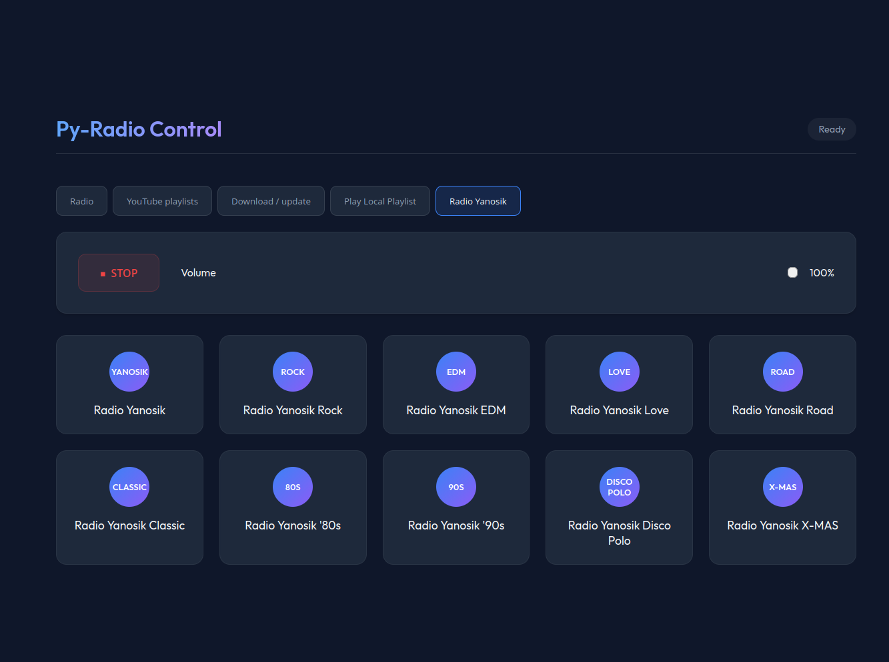

# py-radio

simple online radio player python app










## Additional supported stations

* [Program 1](https://stream11.polskieradio.pl/pr1/pr1.sdp/playlist.m3u8)
* [Program 2](https://stream12.polskieradio.pl/pr2/pr2.sdp/playlist.m3u8)
* [Program 3](https://stream13.polskieradio.pl/pr3/pr3.sdp/playlist.m3u8)
* [Eska Rock](http://ic1.smcdn.pl/5990-1.mp3)
* [Radio Parada](http://stream4.nadaje.com:15274/live)
* [Radio Żak](http://poznan2.radio.pionier.net.pl:8000/pl/radiozak.ogg)

Radio Niepokalanów is not currently offered in the web app: both its AAC and
MP3 playlist URLs failed to connect during playback testing. Add it back when a
working stream URL is available.

## Testing station playback

Run `python test_stations.py` to test using the VLC command-line player, or
`python test_stations_vlc.py` to test using the `python-vlc` package directly.
Run either on the computer connected to the speakers. Both play each station
for 20 seconds and ask whether you heard audio. The direct API script uses
the supplied HLS URLs to test Program 1, Program 2, and Program 3, along with
direct audio stream URLs for Eska Rock, Radio Parada, and the OGG/MP3 streams
for Radio Żak. The Radio Polskie streams have not yet been confirmed audible.
Radio Niepokalanów is omitted because its playlist URLs did not connect and no
direct stream URL was verified.
The direct API script logs playback states, prompts, and answers in
`test_stations_vlc_api.log`. Change the playback duration with `--duration`,
for example `python test_stations_vlc.py --duration 30`.

## DEV and runtime on linux without containers with MQTT

* Conda env: `conda activate py-radio-env-312`

```
mkdir -p ~/.config/py-radio/
cp -v .config/py-radio/config-mqtt.ini ~/.config/py-radio/config.ini


sudo apt update
sudo apt install python3-vlc python3-requests pulseaudio-utils vlc mosquitto mosquitto-clients python3-boto3 python3-flask python3-pika -y

conda activate py-radio-env-312
pip install paho-mqtt python-vlc requests 

chmod 755 run-radio-backend.sh
./run-radio-backend.sh

#in second terminal
cd web_control
chmod 755 run.sh
./run.sh
```


## Older notes and deployments


### LXD containers setup

Setup required libs 

```
sudo apt update && sudo apt upgrade -y
sudo apt install lxd-installer -y
sudo lxd init

```

Creating and starting container

```
./deploy.sh init

```

Additional operations

```
./deploy.sh start
./deploy.sh stop
./deploy.sh status
./deploy.sh logs
./deploy.sh bash
./deploy.sh delete
```

### AWS SQS controlling messages

http://www.emsoft.ct8.pl/strumienie.php


```
aws sqs send-message --queue-url https://sqs.us-east-2.amazonaws.com/347779256781/py-radio-control-queue --message-body "{\"action\":\"stop\", \"name\":\"\", \"station\":\"\", \"volume\":\"0\"}"


# RMF FM
aws sqs send-message --queue-url https://sqs.us-east-2.amazonaws.com/347779256781/py-radio-control-queue --message-body "{\"action\":\"play\",\"name\":\"Radio RMF FM\",\"station\":\"http://31.192.216.5/rmf_fm\",\"volume\":\"100\"}"


# PR24
aws sqs send-message --queue-url https://sqs.us-east-2.amazonaws.com/347779256781/py-radio-control-queue --message-body "{\"action\":\"play\",\"name\":\"Polskie Radio 24\",\"station\":\"http://stream3.polskieradio.pl:8080/\",\"volume\":\"100\"}"

# WNET 
aws sqs send-message --queue-url https://sqs.us-east-2.amazonaws.com/347779256781/py-radio-control-queue --message-body "{\"action\":\"play\",\"name\":\"WNET\",\"station\":\"http://audio.radiownet.pl:8000/stream64\",\"volume\":\"100\"}"

# REPUBLIKA
aws sqs send-message --queue-url https://sqs.us-east-2.amazonaws.com/347779256781/py-radio-control-queue --message-body "{\"action\":\"play\",\"name\":\"Radio Republika\",\"station\":\"https://stream.radiotvrepublika.pl:8100/mp3\",\"volume\":\"100\"}"

# ANTY Radio
aws sqs send-message --queue-url https://sqs.us-east-2.amazonaws.com/347779256781/py-radio-control-queue --message-body "{\"action\":\"play\",\"name\":\"Anty Radio\",\"station\":\"http://redir.atmcdn.pl/sc/o2/Eurozet/live/antyradio.livx\",\"volume\":\"100\"}"


# ZET
aws sqs send-message --queue-url https://sqs.us-east-2.amazonaws.com/347779256781/py-radio-control-queue --message-body "{\"action\":\"play\",\"name\":\"ZET\",\"station\":\"http://redir.atmcdn.pl/sc/o2/Eurozet/live/audio.livx\",\"volume\":\"100\"}"

# ESKA Lodz http://ic1.smcdn.pl/2100-1.aac
aws sqs send-message --queue-url https://sqs.us-east-2.amazonaws.com/347779256781/py-radio-control-queue --message-body "{\"action\":\"play\",\"name\":\"ESKA Lodz\",\"station\":\"http://ic1.smcdn.pl/2100-1.aac\",\"volume\":\"100\"}"

# ZLOTE PRZEBOJE
aws sqs send-message --queue-url https://sqs.us-east-2.amazonaws.com/347779256781/py-radio-control-queue --message-body "{\"action\":\"play\",\"name\":\"ZLOTE PRZEBOJE\",\"station\":\"https://radiostream.pl/tuba8918-1.mp3\",\"volume\":\"100\"}"

# PLUS Lodz https://liveradio.timesa.pl/4100-1.aac/playlist.m3u8

aws sqs send-message --queue-url https://sqs.us-east-2.amazonaws.com/347779256781/py-radio-control-queue --message-body "{\"action\":\"play\",\"name\":\"PLUS Lodz\",\"station\":\"https://liveradio.timesa.pl/4100-1.aac/playlist.m3u8\",\"volume\":\"100\"}"

# Melo radio http://ml04.cdn.eurozet.pl/mel-ldz.mp3
aws sqs send-message --queue-url https://sqs.us-east-2.amazonaws.com/347779256781/py-radio-control-queue --message-body "{\"action\":\"play\",\"name\":\"Melo Radio\",\"station\":\"http://ml04.cdn.eurozet.pl/mel-ldz.mp3\",\"volume\":\"100\"}"


```
